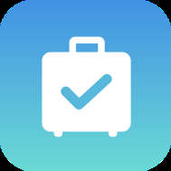
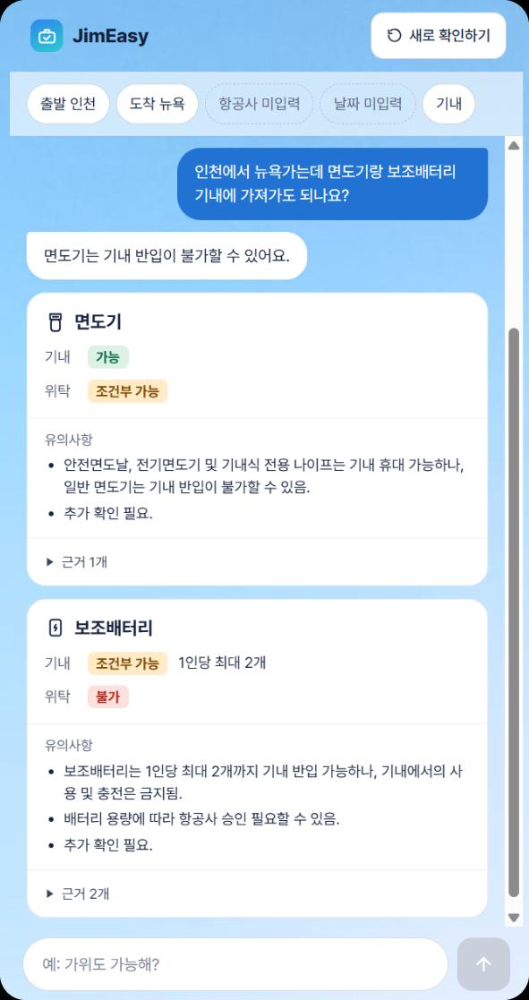
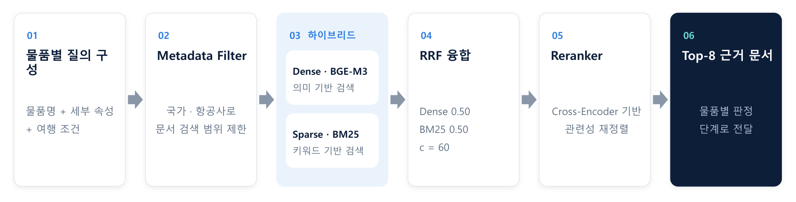

# 짐이지 (JimEasy)

**짐 확인, 이제 쉽게! 여행 조건에 맞춰 공식 근거와 함께 답하는 항공 수하물 반입 규정 안내 AI 챗봇입니다.**
"인천에서 뉴욕 가는데 면도기랑 보조배터리 기내에 가져가도 되나요?"처럼 여러 물품을 한 번에 물으면, 물품마다 기내·위탁 반입 여부를
`가능`·`조건부 가능`·`불가`·`확인 필요` 4단계로 판정하고 근거가 된 공식 문서를 함께 보여 줍니다.

## 레포

| 레포 | 역할 |
|---|---|
| [jimeasy-backend](https://github.com/CARRY-CHECK/jimeasy-backend) | 질의 구조화, 규정 검색(Hybrid + 재정렬), 근거 기반 판정, 대화 API. **여기서 시작하세요.** |
| [jimeasy-frontend](https://github.com/CARRY-CHECK/jimeasy-frontend) | 채팅 화면(React + Vite), 판정 카드와 추가 질문 UI |

## 동작 방식

1. **질의 구조화**: LLM이 질문에서 출발·도착지, 항공사, 여행일, 기내/위탁과 물품 목록을 뽑습니다. 판단에 필요한 정보가 없으면 되묻습니다.
2. **물품별 검색**: 한국·일본·미국·영국·중국의 법령, 공항·항공사·정부 안내에서 여정의 국가·항공사에 맞는 자료를 찾습니다.
3. **근거 기반 판정**: 검색한 문서만 근거로 판정하고, 출처와 시행일을 답에 연결합니다. 근거가 없거나 적용 범위가 불분명하면 `확인 필요`로 안내합니다.

## 빠르게 실행해 보기

백엔드 레포에는 팀이 만든 합성 샘플 데이터가 들어 있어, API 키 없이 단위 테스트와 검색·재정렬 점검을 돌려 볼 수 있습니다.
OpenAI 키를 넣으면 질문·대화까지 실행할 수 있고, 프론트엔드를 켜면 화면에서 확인할 수 있습니다.
자세한 절차는 [백엔드 README](https://github.com/CARRY-CHECK/jimeasy-backend#readme)와 [프론트엔드 README](https://github.com/CARRY-CHECK/jimeasy-frontend#readme)에 있습니다.

## 고지

- 학습·교육 목적의 비상업 프로젝트입니다. 언급한 항공사·공항·정부 기관과 관련이 없으며 이들의 승인이나 후원을 받지 않았습니다.
- 짐이지의 답변은 공식 안내가 아닙니다. 여행 전 이용 항공사·공항·정부의 공식 안내를 확인하세요.
- 레포에는 제3자 자료(규정 원문, 웹 페이지, 수집 결과)가 들어 있지 않습니다. 코드는 각 레포의 MIT 라이선스로 배포하며, MIT 라이선스는 외부 자료에는 적용되지 않습니다.

만든 사람들: [Chaewon-Leee](https://github.com/Chaewon-Leee)(이채원), [jiwoneight](https://github.com/jiwoneight)(정지원), [ginny0825](https://github.com/ginny0825)(김지은), [nickjjang7](https://github.com/nickjjang7)(옥석현)
